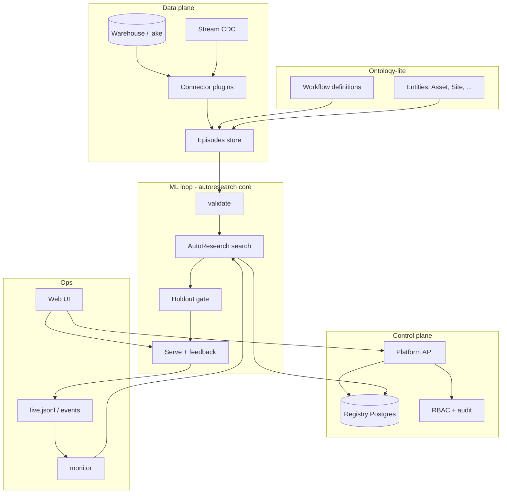
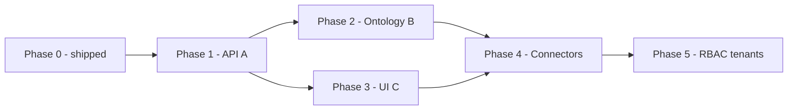

# Platform roadmap — open AutoResearch stack (not Foundry)

**Positioning:** autoresearch-oss is an open **AutoResearch workbench** (episode → search → gate → serve → learn).
Palantir **Foundry** is a full enterprise data + ontology + apps platform. This roadmap grows **compatible ideas**
(registry, lineage, gated models, feedback) without claiming Foundry parity. Keep the disclaimer in README.

**Strategy:** one **core repo** (this project) + optional **satellite repos** when a boundary is clear (UI, connectors pack).

---

## Today vs target

| Layer                 | Today (v0.2)                      | Target                                             |
| --------------------- | --------------------------------- | -------------------------------------------------- |
| Episodes + workflow   | `Workflow`, templates, `validate` | Same + ontology-lite links to shared entities      |
| Registry / lineage    | SQLite file, CLI                  | Postgres (optional), **HTTP registry API**         |
| Search + train + gate | CLI `train`, holdout in `loop.py` | Same + job queue for long LLM runs                 |
| Serve + feedback      | stdlib HTTP, bearer token         | K8s-ready service, OTel metrics, mTLS at edge      |
| Connectors            | CSV/Parquet/JSONL/SQL             | Warehouse + stream plugins (satellite repo)        |
| Object graph          | One workflow JSON per project     | Shared **Asset** / **Case** types across workflows |
| RBAC / audit          | None                              | Roles, audit log, env promotion (dev/stage/prod)   |
| UI                    | None                              | Dashboard: experiments, promote, monitor           |
| Multi-tenant          | Single SQLite writer              | `tenant_id` + isolated DB/schema                   |

---

## Target architecture (all layers)



---

## Repo map

| Repo                                 | Owns                                                       | When to split |
| ------------------------------------ | ---------------------------------------------------------- | ------------- |
| **autoresearch-oss** (this)          | Loop, backends, CLI, registry client, serve, core plugins  | Always        |
| **autoresearch-platform** (future)   | FastAPI registry API, auth middleware, Postgres migrations | Phase 1       |
| **autoresearch-ui** (future)         | React/Vite dashboard                                       | Phase 3       |
| **autoresearch-connectors** (future) | Snowflake, BigQuery, Kafka, Debezium adapters              | Phase 4       |

Until Phase 1 ships, keep Platform API **inside** `autoresearch_oss/platform/` behind a feature flag to avoid premature split.

---

## Wedge A — Platform API (registry + serve control)

**Goal:** UIs and CI call HTTP instead of SQLite paths on disk.

### Milestones

| #   | Deliverable                                        | Notes                                                                            |
| --- | -------------------------------------------------- | -------------------------------------------------------------------------------- |
| A1  | `autoresearch platform serve-api` — read-only REST | `GET /v1/workflows`, `/v1/models`, `/v1/experiments`, `/v1/lineage/{id}`         |
| A2  | Write paths                                        | `POST /v1/models/{id}/promote`, `/rollback`, `POST /v1/train` (async job id)     |
| A3  | Registry backend interface                         | `RegistryBackend`: SQLite (default), Postgres                                    |
| A4  | OpenAPI spec + generated client                    | `openapi.json` in repo                                                           |
| A5  | Harden production serve                            | separate `autoresearch serve` process unchanged; API orchestrates same `Service` |

### API sketch (v1)

```
GET  /health
GET  /v1/tenants/{tenant}/workflows
GET  /v1/tenants/{tenant}/models?workflow=
POST /v1/tenants/{tenant}/models/{id}/promote
GET  /v1/tenants/{tenant}/experiments?workflow=
GET  /v1/tenants/{tenant}/lineage/{artifact_id}
POST /v1/tenants/{tenant}/jobs/train   # body: config ref or inline JSON
GET  /v1/tenants/{tenant}/jobs/{job_id}
```

**Exit criteria:** UI or `curl` can promote v2 without CLI; Postgres optional via `DATABASE_URL`.

---

## Wedge B — Ontology-lite (shared entities)

**Goal:** Multiple workflows reference the same real-world objects (machine, site, customer) without a full graph DB.

### Milestones

| #   | Deliverable                                 | Notes                                                                          |
| --- | ------------------------------------------- | ------------------------------------------------------------------------------ |
| B1  | `EntityType` + `Entity` in registry         | kind=`entity_type`, `entity`; JSON schema for properties                       |
| B2  | Episode **`entity_refs`** column convention | e.g. `asset_id` maps to `Entity(id=…, type=Asset)`                             |
| B3  | Cross-workflow read                         | Same asset never in two train splits across workflows (policy doc + validator) |
| B4  | Export ontology snapshot                    | `autoresearch export-ontology -o ontology.json` for UI                         |

**Not in scope:** SPARQL, full Palantir Object Database clone, visual ontology editor (Phase 3 UI may edit JSON only).

**Exit criteria:** Two workflows (`maintenance-diagnostics`, `support-triage`) share `Customer` entity ids in registry.

---

## Wedge C — UI (Foundry-_feel_, scoped)

**Goal:** Operators see experiments, approve promotion, watch drift — no code.

### Milestones

| #   | Deliverable                | Notes                                                            |
| --- | -------------------------- | ---------------------------------------------------------------- |
| C1  | Static dashboard v0        | Calls Platform API; tables: models, experiments, holdout metrics |
| C2  | Promote / rollback buttons | Confirmation + audit entry                                       |
| C3  | Monitor view               | Charts from `monitor` JSON (PSI, override rate)                  |
| C4  | Serve playground           | Form for workflow inputs → predict (dev only)                    |

**Stack suggestion:** Vite + React, auth via OIDC proxy in front of API.

**Exit criteria:** Non-developer can promote after reading `report.md` equivalent in UI.

---

## Missing layers (phased after wedges)

### Connectors ecosystem (Phase 4)

- Entry-point package `autoresearch_connectors_*`
- Contract: `load_episodes(spec, workflow) -> DataFrame`
- First adapters: Snowflake SQL, S3 Parquet prefix, Kafka JSONL sink for live log
- Document in `docs/extending.md`

### RBAC, audit, environments (Phase 5)

- Roles: `viewer`, `operator`, `admin`
- Audit table: who promoted, when, from which holdout metrics
- Config refs: `autoresearch.dev.json` / `prod.json` — same workflow name, different data paths and thresholds
- Scheduler: document Airflow/cron; optional `autoresearch schedule` wrapper later

### Multi-tenant isolation (Phase 5)

- `tenant_id` on all registry rows
- Separate SQLite per tenant OR Postgres RLS
- Serve: tenant in URL path or JWT claim

---

## Execution order (do not build all at once)



| Phase | Duration (indicative) | Focus                                        |
| ----- | --------------------- | -------------------------------------------- |
| **0** | Done                  | CLI, SQLite, serve, docs, use case           |
| **1** | 2–4 weeks             | Registry HTTP API, Postgres backend, OpenAPI |
| **2** | 2–3 weeks             | Entity types, episode refs, export           |
| **3** | 3–5 weeks             | Dashboard on API                             |
| **4** | ongoing               | Connector plugins repo                       |
| **5** | 4+ weeks              | Auth, audit, tenant isolation                |

---

## Phase 1 — first PRs (concrete)

1. **`autoresearch_oss/registry_backend.py`** — abstract `list`, `get`, `put`, `lineage`; SQLite impl wraps existing `Registry`.
2. **`autoresearch_oss/platform/api.py`** — FastAPI (optional dep `autoresearch-oss[platform]`) read-only routes.
3. **Tests** — `tests/test_platform_api.py` with temp SQLite.
4. **Docs** — this file + OpenAPI hosted in `docs/api.md`.

No Postgres until SQLite backend tests pass and API shape is stable.

---

## Messaging (public)

| Say                                           | Avoid                                                     |
| --------------------------------------------- | --------------------------------------------------------- |
| Open AutoResearch / fine-tuning workbench     | “Open Foundry”                                            |
| Registry + gated deploy + production feedback | “Palantir replacement”                                    |
| Inspired by AutoResearch paper                | Implying feature parity with Foundry AutoResearch product |

---

## Related docs

- [architecture.md](architecture.md) — current single-process diagram
- [use-case-maintenance-diagnostics.md](use-case-maintenance-diagnostics.md) — end-to-end demo
- [extending.md](extending.md) — plugins today
