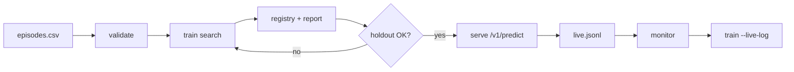

# Use case: fleet maintenance diagnostics

Industrial teams get the same alarm code (`E214`) from different root causes (clogged filter vs failing pump). Historical CSVs show what engineers did and whether the alarm cleared. The wrong action wastes parts and downtime.

**autoresearch-oss** automates: validate data → search training recipes → gate on holdout → serve with approval → learn from overrides.

---

## Business problem

| Stakeholder | Need |
|-------------|------|
| Reliability engineer | Recommend a repair from sensor readings + alarm code |
| Ops lead | Do not ship a model that fails entire fault families (slices) |
| Platform | Audit trail: which data recipe and model version is in production |

**Without** a search + gate loop, teams often train one classifier on “all successful rows.” That looks fine on average but fails on **rare slices** (here: `pump` with only ~26 historical rows).

**With** AutoResearch, probes surface `pump fix≈0.29 (wrongly 'replace_filter')`, the loop adds targeted synthetic mixture, and only models that pass **worst_slice ≥ 0.8 on holdout** can be promoted.

---

## Data (episodes)

One row per case:

| Column | Role |
|--------|------|
| `alarm`, `flow`, `temp`, `ambient`, `vibration` | Model inputs |
| `action` | What was done (label) |
| `outcome_success` | Did the alarm clear? |
| `fault_family` | Slice for per-cause metrics |
| `asset` | Group for splits (no machine in train and holdout) |

Template: `autoresearch init maintenance-diagnostics <dir>`.

---

## End-to-end flow



---

## Run the bundled demo (~1–2 min CPU)

From repo root (editable install + venv):

```bash
pip install -e .
python examples/run_maintenance_use_case.py --fresh
```

Outputs under `examples/maintenance_use_case/`:

- `autoresearch.json` — workflow + thresholds
- `data/episodes.csv` — 8k synthetic rows (same world as `examples/make_example.py`)
- `registry.db` — lineage
- `artifacts/report.md` — experiments, failure modes, holdout metrics

### Manual steps (same use case)

```bash
source .venv/bin/activate
cd examples/maintenance_use_case   # data paths in config are relative to CWD

cp ../episodes.csv data/episodes.csv
autoresearch validate --config autoresearch.json
autoresearch train --config autoresearch.json --promote --db registry.db --out artifacts
autoresearch serve --config autoresearch.json --db registry.db
```

---

## Measured benefit (demo numbers)

Typical run on synthetic data (your `myproj/report.md` will look similar):

| Metric | First full recipe (would ship in naive workflow) | Promoted model |
|--------|--------------------------------------------------|----------------|
| Worst slice (pump) | ~0.29 | ~0.97 |
| Holdout fix rate | Below promotion threshold | ~0.98 |
| Unsafe actions | Tracked vs `restart_no_check` | 0% on holdout |

Additional product benefits visible in the report:

1. **Compute budget** — probe/prune before expensive full trains  
2. **Failure modes** — named slices to fix, not a single accuracy number  
3. **Lineage** — `model → recipe → dataset → workflow` in SQLite  
4. **Ops loop** — `serve` logs JSONL; `monitor` on live CSV; `train --live-log` for v2  

Scores depend on your outcome function (here: offline replay). Synthetic data proves **mechanics**, not real fleet accuracy.

---

## Map to your real fleet

1. Export historian + work-order data into `data/episodes.csv` (same columns).  
2. Set `workflow.thresholds` and `unsafe_actions` in `autoresearch.json`.  
3. Replace replay with a **twin** or labelled eval set when you have simulation or delayed labels (`docs/data-format.md`).  
4. Put `serve` behind TLS + auth; schedule `monitor` on daily exports.

Other templates: `support-triage` (LLM + GPU), `structured-extraction` (verifier-scored JSON).
